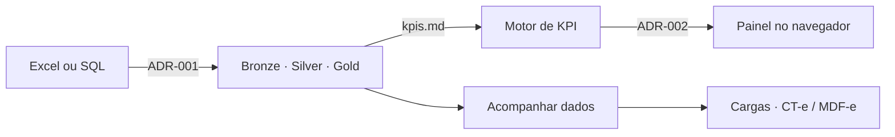

# LogiDash — Índice de Conhecimento

Gerador de painéis logísticos multi-cliente e ferramenta de visualização e acompanhamento de dados comuns de transportadoras (por enquanto, cargas e emissões — estas, documentos fiscais como CT-e e MDF-e), a partir de planilhas ou bancos SQL. A ingestão, o motor de KPI e o painel seguem os [[ADR-001-ingestao-e-normalizacao|ADR-001]], [[ADR-002-stack-renderizacao|ADR-002]] e o [[kpis]]. O recorte de acompanhamento está em [[operacao]], refinado pelo [[ADR-009-operacao-como-visualizacao-e-acompanhamento-de-dados]].

## Fonte da verdade

Esta pasta é a **única fonte da verdade** do projeto. Regras de negócio, decisões de arquitetura e definições de indicadores vivem aqui em Markdown; o código apenas as executa.

Regra de governança: **se uma regra de negócio existe no código mas não existe aqui, ela é um bug de documentação.**

O [[ADR-005-docs-as-code-e-sincronia-obsidian]] (Docs-as-Code e sincronia com Obsidian) está planejado e, quando for escrito, deve descrever `scripts/sync_obsidian.py`. Enquanto isso não acontecer, as notas do LogiDash são gravadas **somente nesta pasta** — sem vault paralelo, pasta espelho ou fluxo de sincronia improvisado.

## Estrutura desta pasta

| Nota | Papel |
| --- | --- |
| Esta nota (`README.md`) | Índice de navegação do LogiDash |
| [[kpis]] | Dicionário vigente dos indicadores (fórmulas, tipos e agregação) |
| [[pendencias]] | Inconsistências e buracos já identificados, ainda sem decisão |
| [[checklist]] | Etapas do projeto, da arquitetura à finalização do escopo documentado |
| [[operacao]] | Visualização e acompanhamento de cargas e emissões fiscais (CT-e, MDF-e e afins; campos ainda a descrever) |
| `adr/` | Uma nota por ADR, numerada; aceito não se edita, é substituído por outro |

## Decisões de arquitetura

| ADR | Assunto | Status |
| --- | --- | --- |
| [[ADR-001-ingestao-e-normalizacao]] | Estratégia de ingestão e normalização (Excel versus SQL) | Aceito |
| [[ADR-002-stack-renderizacao]] | Stack de renderização e motor de dashboards | Aceito |
| [[ADR-003-medallion-com-quarentena]] | Medallion com quarentena — detalhamento | Planejado |
| [[ADR-004-painel-como-especificacao-declarativa]] | Painel como especificação declarativa | Planejado |
| [[ADR-005-docs-as-code-e-sincronia-obsidian]] | Docs-as-Code e sincronia com Obsidian | Planejado |
| [[ADR-006-leitura-de-excel-massivo]] | Estratégia de leitura de Excel massivo | Aguarda benchmark |
| [[ADR-007-otif-promessa-original]] | OTIF medido contra a promessa original | Planejado |
| [[ADR-008-escopo-paineis-e-gestao-operacional]] | Escopo do produto: painéis e gestão operacional | Aceito |
| [[ADR-009-operacao-como-visualizacao-e-acompanhamento-de-dados]] | Operação como visualização e acompanhamento de dados | Aceito |

As notas com status Planejado ou Aguarda benchmark são placeholders de índice: têm título e status, mas **ainda não registram decisão**. Não devem ser lidas como regra nova.

## Modelo de negócio

- [[kpis]] — dicionário de KPIs logísticos com fórmulas, tipos e regras de agregação
- [[checklist]] — etapas do projeto, da arquitetura à finalização do escopo documentado
- [[operacao]] — visualização e acompanhamento de cargas e emissões fiscais (CT-e, MDF-e e afins; campos ainda a descrever)
- [[ADR-008-escopo-paineis-e-gestao-operacional]] — o produto não se limita aos painéis de KPI
- [[ADR-009-operacao-como-visualizacao-e-acompanhamento-de-dados]] — operação como visualizar e acompanhar dados, não um processo geral

## Pendências em aberto

Inconsistências e buracos já notados — inclusive identificadores mistos em inglês e português, a divergência de classe de agregação de `custo_por_kg`, e campos canônicos faltando em `ocupacao_veiculo` e `giro_estoque` — estão em [[pendencias]]. Registrá-los não os resolve; o código não deve escolher a regra no lugar do dicionário.

## Mapa mental do sistema

O caminho Excel/SQL → painel é o que os ADRs 001 e 002 já fecharam. Visualizar e acompanhar cargas e emissões fiscais (CT-e, MDF-e e afins) é o recorte do [[ADR-009-operacao-como-visualizacao-e-acompanhamento-de-dados]] e do [[operacao]]; campos e telas ainda não foram especificados e não devem ser inventados no código.

## Convenções do projeto

- Idioma: código e identificadores em português sem acento (`data_prometida_original`), mensagens ao usuário em português.
- Nomenclatura: `snake_case` em Python, `camelCase` em TypeScript, `snake_case` para IDs de KPI.
- Toda decisão arquitetural relevante vira ADR numerado, e ADR aceito não é editado — é substituído por outro.

## Personas de orquestração

Os ADRs aceitos listam como decisores Arquiteto, Copiloto e Revisor. As regras dessas personas (e das demais) estão no vault, fora desta pasta, em `AI-Orchestration/Skill/`:

- [[🧠_Architect]]
- [[✈️_Copilot]]
- [[🔎_Reviewer]]
- [[🛠️_Assistant]]
- [[👶_Intern]]

Essas notas não são fonte da verdade de regra de negócio do LogiDash.
