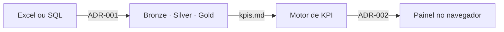

# LogiDash — Índice de Conhecimento

Gerador de painéis logísticos multi-cliente, alimentado por planilhas Excel ou bancos SQL.

Esta pasta é a **fonte da verdade** do projeto. Regras de negócio, decisões de arquitetura e definições de indicadores vivem aqui em Markdown, e o código apenas as executa. O conteúdo é sincronizado com o vault do Obsidian por `scripts/sync_obsidian.py`.

Regra de governança: **se uma regra de negócio existe no código mas não existe aqui, ela é um bug de documentação.**

## Decisões de arquitetura

| ADR | Assunto | Status |
| --- | --- | --- |
| [[ADR-001-ingestao-e-normalizacao]] | Estratégia de ingestão e normalização (Excel versus SQL) | Aceito |
| [[ADR-002-stack-renderizacao]] | Stack de renderização e motor de dashboards | Aceito |
| ADR-003 | Medallion com quarentena — detalhamento | Planejado |
| ADR-004 | Painel como especificação declarativa | Planejado |
| ADR-005 | Docs-as-Code e sincronia com Obsidian | Planejado |
| ADR-006 | Estratégia de leitura de Excel massivo | Aguarda benchmark |
| ADR-007 | OTIF medido contra a promessa original | Planejado |

## Modelo de negócio

- [[kpis]] — dicionário de KPIs logísticos com fórmulas, tipos e regras de agregação

## Mapa mental do sistema

## Convenções do projeto

- Idioma: código e identificadores em português sem acento (`data_prometida_original`), mensagens ao usuário em português.
- Nomenclatura: `snake_case` em Python, `camelCase` em TypeScript, `snake_case` para IDs de KPI.
- Toda decisão arquitetural relevante vira ADR numerado, e ADR aceito não é editado — é substituído por outro.
