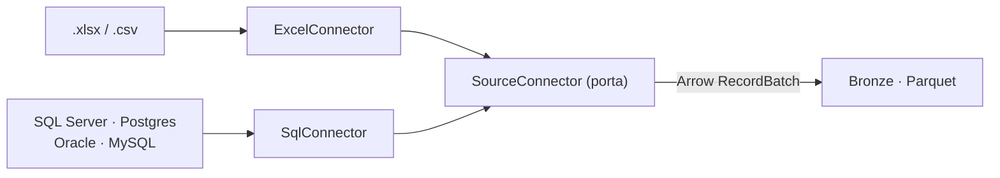
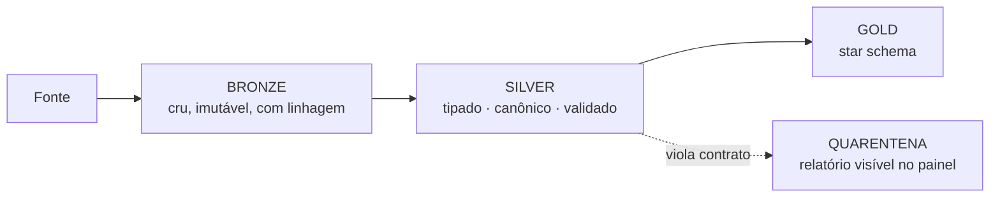

# ADR-001 — Estratégia de Ingestão e Normalização de Dados

## Status

**Aceito** em 2026-08-21. Substitui qualquer abordagem anterior de leitura direta de planilha em memória.

Depende de um benchmark pendente para fixar a biblioteca de leitura de Excel — ver [Questões em aberto](#questões-em-aberto).

## Contexto

O LogiDash precisa gerar painéis logísticos a partir de duas classes de fonte com características tecnicamente opostas.

| Dimensão | Excel / CSV | Banco SQL |
| --- | --- | --- |
| Natureza | Arquivo estático enviado pelo usuário | Servidor com dado vivo |
| Tipagem | Ausente ou não confiável (data como texto, número como string) | Declarada e confiável |
| Estabilidade de schema | Instável — muda entre meses e entre filiais | Estável, versionada por migração |
| Capacidade de computação | Nenhuma | Alta — agregação pode ser empurrada |
| Volume esperado | Acima de 100 MB por arquivo | Tabelas de milhões de linhas |
| Reprodutibilidade | Alta — o arquivo é imutável | Baixa — a mesma query muda de resultado |

Três forças adicionais restringem a solução.

**O vocabulário é inconsistente.** A mesma informação chega como `TRANSP`, `Transportadora`, `Carrier`, `NOME_TRANSP` ou `Nm_Transp` em planilhas do mesmo cliente. Qualquer lógica de KPI escrita contra nomes físicos de coluna é descartável.

**A memória é o recurso escasso.** Um `.xlsx` de 100 MB descomprime para 1–2 GB de XML. Em um serviço multi-cliente, uma única ingestão ingênua derruba o nó e afeta todos os outros clientes.

**O isolamento entre clientes é requisito de negócio.** Vazamento de dados de frete ou de carteira de clientes entre tenants é evento terminal para o produto.

A tentação óbvia — escrever um caminho de código para Excel e outro para SQL — leva a duas implementações de cada KPI, que divergem em semanas e produzem números diferentes para a mesma pergunta.

## Decisão

### 1. Porta única `SourceConnector`, com adaptadores por tipo de fonte

Toda fonte implementa o mesmo contrato. O núcleo de domínio nunca sabe se o dado veio de planilha ou de banco.

### 2. Apache Arrow é a fronteira do sistema

O contrato de saída de todo conector é um fluxo de `pyarrow.RecordBatch` mais um `SourceSchema` descritivo. Arrow é escolhido por ser colunar, fortemente tipado, *zero-copy* entre Polars, DuckDB e PyArrow, e por permitir *streaming* com memória constante.

**Rejeitamos `pandas.DataFrame` como fronteira**: tipagem fraca (o infame `object` dtype), consumo de memória entre 5 e 10 vezes o tamanho do arquivo, e materialização obrigatória do dataset inteiro.

### 3. Bronze é sempre materializado em Parquet, inclusive para fontes SQL

Toda ingestão produz um artefato imutável em `lake/{tenant_id}/bronze/{source_id}/{ingestion_id}.parquet`, acompanhado do hash SHA-256 da origem e do timestamp de ingestão.

Para fontes SQL isso significa tirar um *snapshot*, e não consultar o banco do cliente a cada carregamento de painel. É uma decisão deliberada com dois motivos: preserva a reprodutibilidade (o painel de ontem continua mostrando os números de ontem) e protege o banco transacional do cliente contra carga analítica.

**Existe uma exceção controlada.** Fontes SQL podem ser marcadas com `modo: FEDERATE`, em que a agregação é empurrada para o banco de origem e apenas o resultado agregado trafega. Usar somente quando o volume torna a materialização inviável e o cliente aceita a perda de reprodutibilidade.

### 4. Pipeline Medallion com quarentena explícita

Linhas que violam o contrato **não são descartadas silenciosamente nem contaminam o KPI**. Vão para um relatório de rejeição exibido junto ao painel. Um OTIF calculado sobre 60% das linhas sem aviso é pior do que nenhum número.

### 5. Normalização em três etapas, com o humano no circuito

**Perfilagem.** Amostragem de no máximo 1.000 linhas para inferir tipo lógico, cardinalidade, taxa de nulos e exemplos. Nunca lê o arquivo inteiro para descobrir o schema.

**Mapeamento semântico em cascata**, da maior para a menor confiança:

1. Mapeamento explícito declarado no `SourceSpec` — confiança total.
2. Dicionário de sinônimos versionado em `docs/ontologia/` — confiança alta.
3. Similaridade de string e compatibilidade de tipo — **apenas sugestão**, exige confirmação do usuário.

**Nunca há mapeamento automático silencioso.** Um campo `custo` mapeado por engano para `valor_frete` produz um painel confiante e falso, que é o pior resultado possível de um sistema analítico. Toda inferência da etapa 3 fica pendente até aprovação humana, e a aprovação é registrada em trilha de auditoria.

**Validação de contrato** com Pandera sobre a camada Silver, aplicando regras de domínio: `data_entrega >= data_coleta`, `peso_bruto_kg > 0`, `qtd_entregue <= qtd_expedida`.

### 6. Streaming com memória limitada

A conversão para Parquet acontece em passagem única: lotes de linhas viram `RecordBatch`, que são gravados incrementalmente como *row groups*. O pico de memória é função do tamanho do lote, não do tamanho do arquivo — 500 MB e 5 GB consomem o mesmo.

Cada worker roda com teto de memória declarado. Ao exceder, o job falha de forma limpa e observável, em vez de degradar o nó.

### 7. Defesas obrigatórias no upload

- Verificação da razão de compressão pelo diretório central do ZIP **antes** de descomprimir, bloqueando *zip bomb*.
- Teto absoluto de bytes descomprimidos por job.
- Upload direto para o object storage via URL assinada — o byte do cliente nunca atravessa o servidor de API.
- Credenciais de banco **nunca** residem no `SourceSpec`. O spec carrega apenas uma referência (`credencial_ref`) resolvida no cofre em tempo de execução.
- O usuário de banco configurado para fontes SQL é estritamente somente-leitura.

## Consequências

### Positivas

- Uma única implementação de cada KPI, independente da origem do dado.
- O núcleo de domínio é testável sem I/O, sem banco e sem arquivo.
- Trocar Excel por SQL não afeta nenhum painel já construído.
- Consumo de memória previsível e limitável, condição necessária para multi-tenant.
- Linhagem auditável: dá para provar de qual arquivo e de qual momento veio cada número.
- Adicionar uma fonte nova (API REST, Google Sheets, Parquet) é escrever um adaptador, sem tocar no núcleo.

### Negativas

- **Latência adicional em fontes SQL** por causa da materialização. Mitigação: ingestão incremental por marca d'água e agendamento.
- **Custo de armazenamento duplicado**, já que Bronze e Silver coexistem. Mitigação: política de retenção e compactação; Parquet comprimido costuma ficar bem abaixo do original.
- **Fricção no onboarding**, porque a primeira ingestão de cada fonte exige confirmação humana do mapeamento. Aceita conscientemente: é o preço de não produzir números errados com confiança.
- **Disciplina de tipos exigida do time.** Arrow é rígido, e conversões mal feitas falham cedo — o que é desejável, mas exige cuidado com formato numérico pt-BR (`1.234,56`) e datas serializadas como texto.

### Riscos

| Risco | Impacto | Mitigação |
| --- | --- | --- |
| Schema da planilha muda sem aviso | Painel quebra ou calcula errado | Perfilagem comparada com a ingestão anterior; alerta de desvio antes de processar |
| Biblioteca de Excel não sustenta iteração preguiçosa | Estouro de memória em arquivos grandes | Benchmark obrigatório antes de fixar (ver questões em aberto) |
| Mapeamento aprovado incorretamente pelo usuário | KPI silenciosamente errado | Mapeamento versionado e reversível; painel exibe a proveniência de cada campo |

## Alternativas consideradas e rejeitadas

**Dois pipelines independentes, um por tipo de fonte.** Rejeitado: duplica a lógica de KPI e garante divergência de números entre origens em poucas semanas.

**Pandas como estrutura de dados de fronteira.** Rejeitado por consumo de memória e tipagem fraca, incompatíveis com o requisito de arquivos acima de 100 MB em ambiente compartilhado.

**Consulta federada sempre, sem materialização.** Rejeitado como padrão: transfere carga analítica para o banco transacional do cliente e destrói a reprodutibilidade histórica. Mantido como modo opcional.

**Mapeamento semântico totalmente automático por LLM.** Rejeitado como caminho padrão. O modo de falha é silencioso e produz números plausíveis porém errados, que é exatamente o que um sistema de decisão logística não pode fazer. Aceitável apenas como gerador de sugestões na etapa 3.

**Carregar tudo em Postgres e usar SQL do Postgres.** Rejeitado: custo de escrita alto para dados analíticos, e desempenho de agregação colunar muito inferior ao DuckDB sobre Parquet.

## Questões em aberto

- **Benchmark de leitura de Excel** comparando `python-calamine` e um leitor SAX em streaming, sobre um arquivo real de 200 MB, medindo tempo e pico de memória. O resultado fixa a implementação e será registrado no ADR-006.
- Definir a estratégia de ingestão incremental para fontes SQL: marca d'água por timestamp, por chave crescente, ou captura de mudanças.

## Referências

- [[ADR-002-stack-renderizacao]] — como o dado normalizado vira painel
- [[kpis]] — os campos canônicos que a normalização precisa produzir
