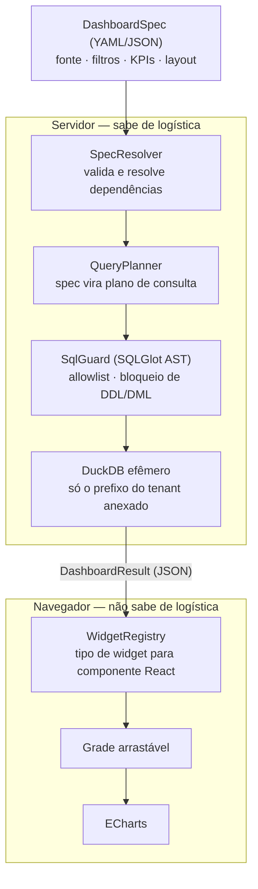

# ADR-002 — Stack de Renderização e Arquitetura do Motor de Dashboards

## Status

**Aceito** em 2026-08-21. Esta decisão reverte uma recomendação preliminar de usar Streamlit, feita antes de sabermos que o produto seria SaaS multi-cliente.

## Contexto

O LogiDash não é um dashboard. É um **gerador** de dashboards, operado como SaaS multi-cliente com login e isolamento de dados.

Essa distinção define tudo. Se cada painel fosse código, teríamos trinta arquivos copiados-e-colados em seis meses e nenhuma regra de negócio reaproveitável. O painel precisa ser um **dado declarativo** — o `DashboardSpec` — interpretado por um motor genérico.

Os requisitos que restringem a escolha:

- **Isolamento entre clientes** verificável e auditável, não implementado como `if` espalhado pela aplicação.
- **Autorização granular**: quem pode ver qual painel, qual fonte e qual filial dentro do mesmo cliente.
- **Layout dinâmico** definido em tempo de execução pela especificação, e rearranjável pelo usuário final.
- **Volume de pontos alto**: séries de rastreamento de entregas facilmente ultrapassam 100 mil pontos.
- **Concorrência** de múltiplos clientes sem que a sessão de um afete a latência do outro.
- **Marca branca**, já que o painel será apresentado ao cliente final do nosso cliente.

## Decisão

### 1. Stack: FastAPI no backend, Next.js e TypeScript no frontend

| Camada | Escolha | Razão |
| --- | --- | --- |
| API | FastAPI | Async nativo, Pydantic no núcleo, OpenAPI gerado automaticamente |
| Frontend | Next.js + TypeScript | SSR, roteamento por tenant, ecossistema maduro |
| Gráficos | Apache ECharts | Renderização em canvas; sustenta 100 mil+ pontos e mapas de rota |
| Layout | react-grid-layout | Grade arrastável e redimensionável — requisito de "gerador" |
| Motor analítico | DuckDB efêmero | Fora do núcleo, uma instância por consulta, com teto de memória |
| Contrato | Cliente TS gerado do OpenAPI | O compilador verifica o acordo entre backend e frontend |

A geração do cliente TypeScript a partir do OpenAPI é intencional: qualquer quebra de contrato entre as camadas falha no build, não em produção.

### 2. Separação entre motor e renderizador

O ponto arquitetural central é que **toda lógica logística vive no servidor** e o frontend é deliberadamente burro em relação ao domínio.



O frontend recebe um `DashboardResult` genérico — séries, rótulos, unidades, formatação, metas — e não contém nenhuma noção de OTIF, frete ou estoque. Consequência prática: **um KPI novo entra no produto sem deploy de frontend**, bastando uma definição YAML no servidor.

### 3. O `DashboardSpec` é o contrato e a fonte da verdade

```yaml
id: painel_entregas_sudeste
titulo: Desempenho de Entregas — Sudeste
tenant_id: "{{ resolvido pelo token, nunca pelo spec }}"

fonte:
  source_id: embarques_2026
  modo: MATERIALIZE

filtros:
  - campo: data_entrega
    operador: entre
    valor: [2026-01-01, 2026-08-31]
  - campo: regiao_destino
    operador: igual
    valor: Sudeste

layout:
  - tipo: kpi_card
    kpi: otif
    largura: 3
  - tipo: kpi_card
    kpi: lead_time_medio
    largura: 3
  - tipo: barra_horizontal
    kpi: otif
    dimensao: transportadora
    ordenar: asc
    limite: 10
    largura: 6
  - tipo: histograma
    kpi: desvio_prazo_dias
    largura: 12
```

O `tenant_id` **nunca** vem do spec. É sempre derivado do token de autenticação. Um spec que tentasse declará-lo é rejeitado na validação — caso contrário teríamos escalonamento horizontal de privilégio por edição de YAML.

### 4. Isolamento em três camadas independentes

Cada camada é suficiente sozinha; as três juntas tornam o vazamento improvável.

**No banco de metadados.** Row-Level Security do PostgreSQL com `SET LOCAL app.tenant_id` por transação. Uma query que esqueça o filtro retorna zero linhas em vez de dados alheios — o modo de falha é seguro por construção.

**No armazenamento.** Prefixo por cliente e credenciais temporárias com política de sessão restrita àquele prefixo. O worker não consegue enxergar arquivos de outro cliente.

**No motor analítico.** Cada consulta abre um DuckDB efêmero onde apenas os Parquet daquele cliente são registrados como views. Mesmo que uma SQL maliciosa escape da validação, não existe mais nada anexado para alcançar.

### 5. O motor de KPI monta SQL, e por isso é o maior risco do sistema

Como as definições de KPI são SQL parametrizado carregado de YAML, existe uma superfície real de injeção que, em ambiente multi-cliente, significaria exfiltração entre tenants.

Mitigação **bloqueante de release**: toda SQL passa por *parse* em AST com SQLGlot antes de executar, com allowlist de funções, bloqueio total de DDL e DML, e identificadores sempre citados via API. Nenhuma SQL do sistema pode ser construída por interpolação de string, e isso vira regra automatizada no CI.

## Consequências

### Positivas

- Isolamento e autorização implementados na camada correta, e testáveis automaticamente.
- Um KPI novo é uma definição YAML, sem deploy de frontend.
- Desempenho controlável: agregação acontece no DuckDB e trafega apenas o resultado.
- Marca branca e personalização visual são triviais no Next.js.
- Contrato entre camadas verificado pelo compilador.
- O `DashboardSpec` é legível por humanos, versionável em Git e indexável no Obsidian — o painel vira documentação.

### Negativas

- **Custo inicial significativamente maior** que o de uma ferramenta Python de página única. Aceito: é o preço de um produto multi-cliente.
- **Dois runtimes** (Python e Node) para operar, observar e implantar.
- **O time precisa de competência em TypeScript e React**, não apenas Python.
- **Latência de primeira consulta** enquanto o DuckDB abre e registra as views. Mitigação: cache endereçado por conteúdo, com chave derivada de hash da fonte, versão do spec e parâmetros.

## Alternativas consideradas e rejeitadas

**Streamlit.** Era a recomendação preliminar e foi descartada ao confirmarmos o modelo SaaS. Não oferece autorização granular auditável, seu modelo de re-execução total do script torna o estado frágil, e o custo por sessão não escala para múltiplos clientes concorrentes. Continua sendo excelente para ferramenta interna de time único — não é o nosso caso.

**Dash (Plotly).** Tecnicamente superior ao Streamlit para layouts dinâmicos, graças às *pattern-matching callbacks*. Rejeitado porque os callbacks vivem no servidor Python e acoplam o layout ao backend, o que degrada com muitos clientes simultâneos e dificulta marca branca. Se o produto fosse interno, seria a escolha.

**Superset ou Metabase embarcado (comprar em vez de construir).** A alternativa mais séria, e a que exigiu mais análise. Rejeitada por dois motivos: o modelo semântico logístico — a ontologia canônica e o dicionário de KPIs, que são o ativo real do produto — ficaria preso dentro da ferramenta, em formato proprietário e não indexável no Obsidian; e o licenciamento e a operação de *embedding* multi-cliente com marca branca adicionam complexidade comparável à de construir. Reavaliar caso o roadmap passe a priorizar exploração ad-hoc pelo usuário final, cenário em que comprar volta a fazer sentido.

**Recharts em vez de ECharts.** Rejeitado por ser baseado em SVG: acima de poucos milhares de pontos o navegador trava. Séries de rastreamento de entregas ultrapassam esse limite rotineiramente.

**Plotly.js.** Boa cobertura funcional, mas o tamanho do bundle penaliza o carregamento inicial de um produto voltado a uso operacional diário.

## Questões em aberto

- Definir se o usuário final poderá **editar** o `DashboardSpec` pela interface ou apenas escolher entre painéis pré-definidos. A primeira opção amplia a superfície de segurança do motor de SQL e exige validação ainda mais rígida.
- Escolher o provedor de identidade (OIDC gerenciado versus autenticação própria).

## Referências

- [[ADR-001-ingestao-e-normalizacao]] — de onde vem o dado que o motor consulta
- [[kpis]] — as definições que o motor compila em SQL
